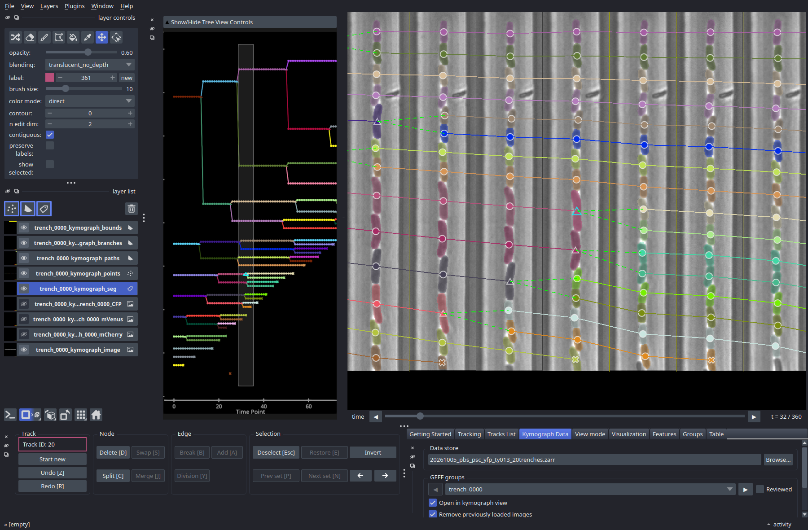
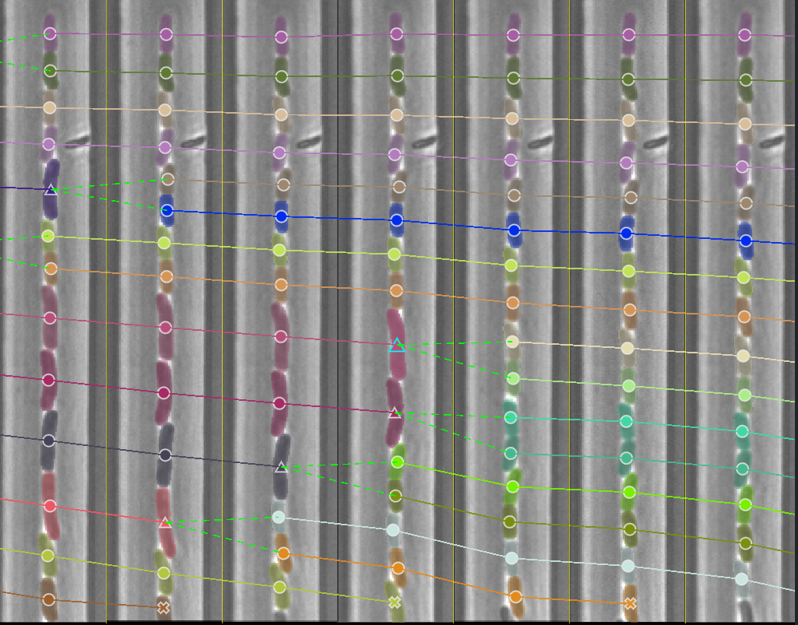

# mm-track

mm-track is a napari plugin for curating cell lineages in mother machine trenches.
You open a trench's tracking results as a kymograph beside its lineage tree, fix the
mistakes, and mark the trench reviewed when you're done with it.

It began as a fork of [Motile Tracker](https://github.com/funkelab/motile_tracker),
now [napari-track-edit](https://github.com/live-image-tracking-tools/napari-track-edit).
mm-track is bult for mother machine views and a curation workflow built
around [GEFF](https://github.com/live-image-tracking-tools/geff) files.



## What mm-track adds

- A kymograph view shows a trench's frames side by side with the tracks drawn over
  them. It lists every channel of the trench image and can draw other image layers
  on top.
- The lineage tree is laid out in trench order, with time running left to right by
  default. It follows the kymograph along time and shades the frames the kymograph
  is showing. Shift+drag selects the nodes in a box, in the tree and in the
  kymograph.
- Given a zarr store with one GEFF group per trench, each holding its image and
  segmentation, you step through the trenches one at a time.
- You can split a cell in two or merge nodes into one, each as a single undo step,
  and merge a cell's pieces across several frames at once.
- Edits go straight to the GEFF, with an edit history kept beside it, so you can
  close napari and pick up where you left off.



## Installation

mm-track needs Python 3.11 or later.

```bash
pip install "mm-track @ git+https://github.com/georgeoshardo/mm-track"
```

## Usage

Start mm-track on a store of GEFF groups:

```bash
mm_track --data experiment.zarr
```

This opens napari with all the menus and the lineage tree, and loads the first
trench into the kymograph. The options are:

| Option | What it does |
| --- | --- |
| `--data STORE` | Zarr store holding GEFF groups with their images and segmentations |
| `--group NAME` | Group to load instead of the first, e.g. `trench_0396` |
| `--run NAME` | For a PyMMM experiment: the tracking run to list (default: the first recorded) |
| `--spatial` | Show the data in the spatial view instead of the kymograph |
| `--mode {all,tracking,editing}` | Which widgets to open (default: `all`) |

From inside napari, open everything with Plugins > mm_track > Open all widgets, then
pick a store in the Kymograph Data menu.

The lineage tree is drawn on the GPU with fastplotlib. Where that can't run, it falls
back to pyqtgraph; set `MM_TRACK_TREE_BACKEND=pyqtgraph` to use pyqtgraph anyway.

The documentation in [docs](docs/source) is still Motile Tracker's. It covers the
tracking and editing that mm-track inherited, but not the mother machine features.

## License and credit

mm-track is a fork of motile-tracker, now called [napari-track-edit](https://github.com/live-image-tracking-tools/napari-track-edit) and I'm very thankful for all the hard work going into that project. 